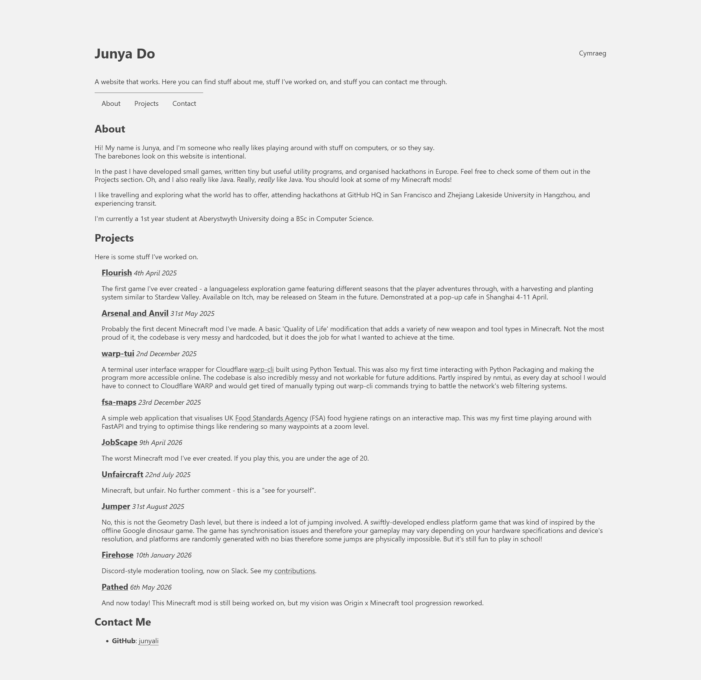

# Website that works

A website that works. Currently hosted on the root URL of [my GitHub Pages deployment](https://junyali.github.io/).

## It works

No literally, it gets the job done. It's minimalist, has a Welsh translation (because why not!), and doesn't use JavaScript at all. I do miss when the internet wasn't about flashy pages or a chock ton of tracking, telemetry, and overwhelming designs that aren't accessibility friendly.

## Getting to work

Otherwise known as deployment. It's just a static web page. Pages can be served directly from the root at `index.html`.
